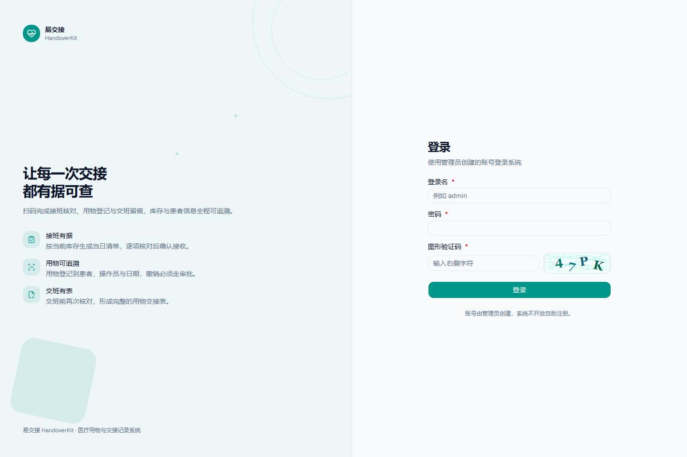
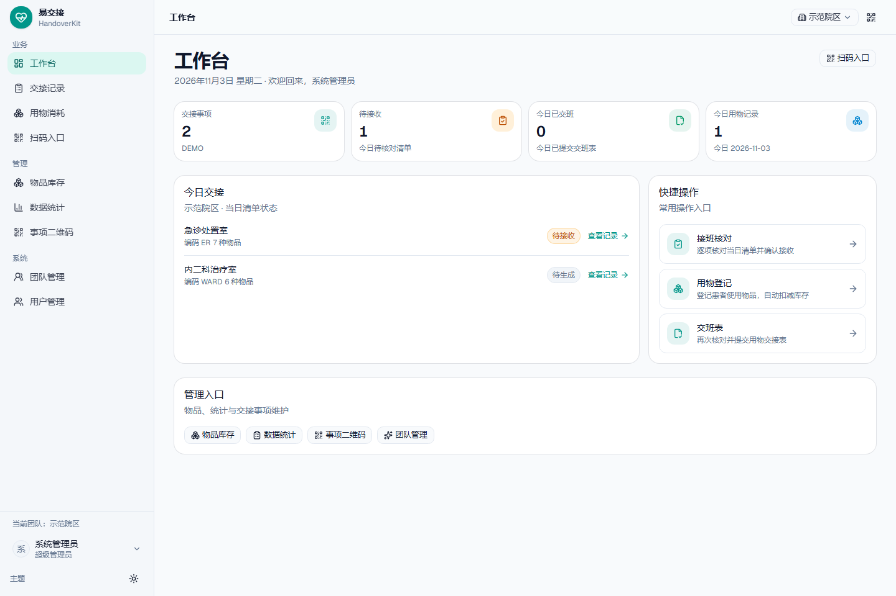
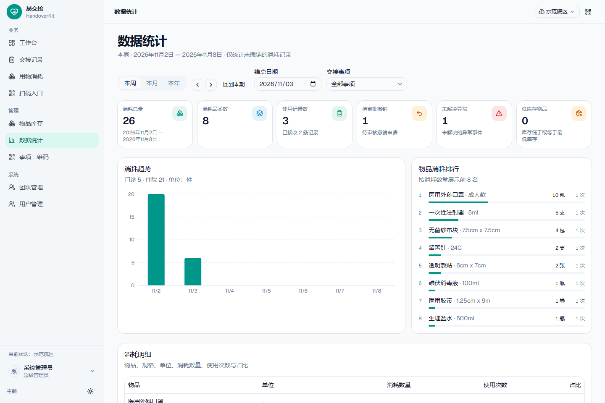
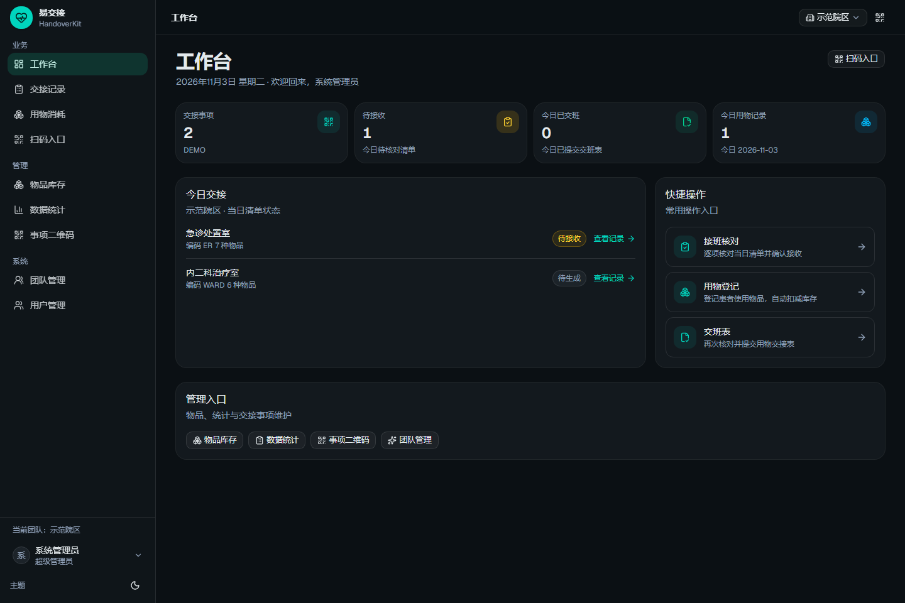
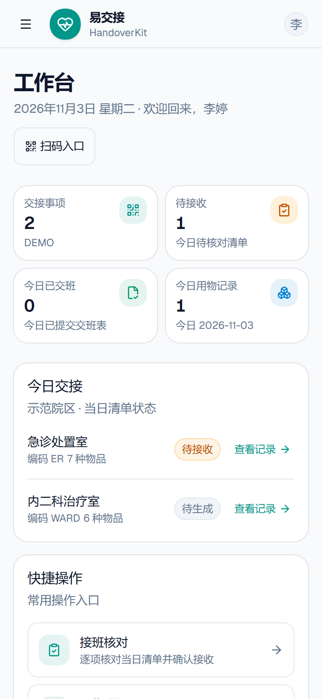
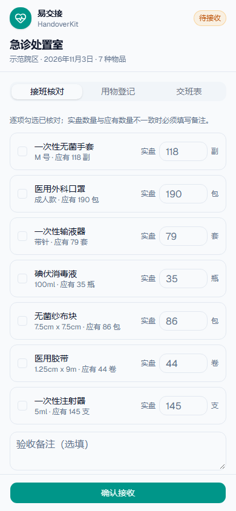

# 易交接 · HandoverKit

> 面向科室/院区的用物与交接记录系统：扫码交接、库存可追溯、消耗审批、数据统计。

[](https://viteplus.dev)
[](#license)

## 界面预览

| 登录（验证码）                      | 工作台                                    |
| ----------------------------------- | ----------------------------------------- |
|  |  |

| 数据统计                                | 深色模式                                           |
| --------------------------------------- | -------------------------------------------------- |
|  |  |

| 移动端工作台（375px）                                  | 扫码交接（移动端 375px）                    |
| ------------------------------------------------------ | ------------------------------------------- |
|  |  |

## 功能一览

- **登录与验证码**：用户名 + 密码 + 服务端图形验证码，失败限流；账号由管理员创建，不开放自助注册。
- **多团队隔离**：超级管理员创建团队；团队管理员管理本团队数据；普通用户只能访问所属团队。
- **交接事项与固定二维码**：每个交接事项对应一个用物仓库，生成固定二维码（/scan/{token}），可手动申请变更使旧码失效。
- **子仓库**：一个事项下可划分门诊仓库、住院仓库等子仓库；物品与库存按子仓库独立管理，接班清点、交接记录也按子仓库独立进行。
- **接班核对**：扫码后先选择子仓库，系统按该子仓库当前库存生成/读取当日清单；接班人逐项核对、确认接收，差异写入清单但不会自动生成异常。
- **用物消耗登记**：从事项库存中选择物品（禁止手输），登记患者信息、数量、使用日期与操作员；库存事务扣减。物品可跨子仓库选择，按来源子仓库扣库存（门诊从住院仓库借用的真实场景）。
- **补登记**：独立的「补登记」入口，必须登录；记录使用日期、使用时间、数量与补录原因，可绕过接班门禁补录历史消耗。
- **交班表**：交班前再次核对清单并提交，形成「接收 → 使用 → 交接」闭环；有差异必须先异常上报才能交班。
- **物资调拨**：管理员可在同一事项的不同子仓库间调拨物资，调入仓库无同名同规格物品时自动建档，双边库存与流水事务一致。
- **流程门禁**：未完成接班确认不能登记用物或交班；接班核对发现数量差异时，必须先完成异常上报，才能登记用物消耗和提交交班表；普通登记在交班后不可用（改用补登记）。
- **撤销审批**：消耗记录撤销需管理员审批，通过后库存自动恢复并留痕。
- **物品与库存**：按子仓库管理物品增删改查、入库、盘点调整、低库存预警、不可变库存流水、子仓库调拨。
- **数据统计**：按周/月/年分析消耗趋势、物品排行、明细与预警。
- **异常事件**：发现、上报、处置闭环。
- **管理能力**：团队、用户（创建/编辑/重置密码/停用）、交接事项、二维码、物品、统计。
- **移动端适配**：320–768px 全页面无横向溢出；触控目标 44px、弹窗自适应滚动、扫码页三功能竖排 + 底部安全区，手机扫码即可完成交接。

## 角色

| 角色       | 能做什么                                                                  |
| ---------- | ------------------------------------------------------------------------- |
| 超级管理员 | 跨团队管理；团队增删改查；任意团队用户管理；全部业务权限                  |
| 团队管理员 | 本团队用户管理、交接事项与二维码、物品/库存、交接记录管理、撤销审批、统计 |
| 普通用户   | 接班核对、用物消耗登记（含补登记）、交班表、撤销申请、异常上报            |

## 技术栈

- **前端**：React 19、TanStack Router、TanStack Query、Tailwind CSS v4、shadcn/ui、lucide-react
- **后端**：Hono、oRPC（端到端类型安全）、Zod
- **数据**：SQLite（WAL）+ Drizzle ORM（迁移随镜像发布）
- **认证**：Better Auth（username 插件，scrypt）
- **工程**：Vite+（dev/build/test/lint/format）、Playwright、Docker Compose

## 快速开始（本地开发）

环境要求：Node 24（^24.11）、pnpm 12。

```bash
pnpm install
cp apps/server/.env.example apps/server/.env
pnpm run db:migrate
pnpm run dev   # web:5173  api:3000
```

首次启动会创建超级管理员：账号 `admin` / 密码 `Admin@123456`。

> 生产部署请通过环境变量覆盖 `SEED_ADMIN_PASSWORD`，登录后立即在「个人中心」修改密码。

## 发布与部署

### 一键安装（GitHub Release，推荐）

打 tag（如 `v0.1.2`）会自动触发 GitHub Actions：质量门禁 → 构建镜像推送 GHCR → 创建 Release 并上传部署资产。服务器上一条命令：

```bash
curl -fsSL https://github.com/Eunsolfs/HandoverKit/releases/latest/download/handoverkit-ops.sh -o /tmp/ops.sh
sudo bash /tmp/ops.sh install
```

安装完成后输出访问地址与初始管理员账号；后续运维用同一脚本：

```bash
sudo bash /opt/handoverkit/ops.sh status     # 状态/健康检查
sudo bash /opt/handoverkit/ops.sh upgrade    # 升级（自动备份，可 rollback）
sudo bash /opt/handoverkit/ops.sh backup     # 备份 SQLite + .env
sudo bash /opt/handoverkit/ops.sh logs       # 日志
```

详见 [docs/release-and-ops.md](docs/release-and-ops.md)（发布流程、一键安装、升级回滚、备份恢复、离线/私有镜像、1Panel 反代 HTTPS、FAQ）。

### 从源码构建（开发 / 自定义）

```bash
cp .env.example .env      # 填写 BETTER_AUTH_SECRET / BETTER_AUTH_URL
docker compose up -d --build
```

- 数据库持久化在 Docker 数据卷 `data`（容器内 `/data/app.db`）。
- `migrate` 服务在应用启动前自动执行迁移，升级只需重建镜像并 `docker compose up -d`。
- 1Panel 手动步骤见 [docs/deployment-1panel.md](docs/deployment-1panel.md)。
- 镜像构建、Release Compose、一键脚本已用 Docker Desktop（Engine 29.9.2 / Compose v5.6.1）实机验证；详见 [docs/release-and-ops.md](docs/release-and-ops.md) 的实测记录。

## 环境变量

| 变量                  | 必填     | 说明                                                      |
| --------------------- | -------- | --------------------------------------------------------- |
| `BETTER_AUTH_SECRET`  | 生产必填 | 会话签名密钥，32+ 随机字符                                |
| `BETTER_AUTH_URL`     | 是       | 浏览器访问的站点地址（含协议/端口），反代后必须是公网地址 |
| `DATABASE_URL`        | 是       | SQLite 路径；Docker 内为 `/data/app.db`                   |
| `PORT`                | 否       | 服务端口，默认 3000                                       |
| `SEED_ADMIN_USERNAME` | 否       | 首次启动创建的超管账号，默认 `admin`                      |
| `SEED_ADMIN_PASSWORD` | 否       | 首次启动创建的超管密码，默认 `Admin@123456`               |
| `SEED_ADMIN_NAME`     | 否       | 超管姓名，默认「系统管理员」                              |

## 文档

| 文档                                     | 内容                                             |
| ---------------------------------------- | ------------------------------------------------ |
| [需求规格](docs/requirements.md)         | 角色权限矩阵、业务流程、FR-01..FR-11、非功能需求 |
| [数据模型](docs/data-model.md)           | ER 图、表结构、不变量与事务、索引                |
| [API 契约](docs/api-contract.md)         | 认证接口、DTO、oRPC procedures、错误码、权限     |
| [架构设计](docs/architecture.md)         | 技术栈、请求链路、安全模型、扩展点               |
| [设计系统](docs/design-system.md)        | 色彩/字体/布局/组件/页面模式/无障碍              |
| [开发规划](docs/dev-plan.md)             | 里程碑、分工、写作用域、风险                     |
| [1Panel 部署](docs/deployment-1panel.md) | Compose、反向代理、备份、升级                    |
| [避坑记录](docs/pitfalls.md)             | 环境、Drizzle、Better Auth、Windows 等真实踩坑   |
| [更新日志](CHANGELOG.md)                 | 版本与里程碑变更                                 |

## 项目结构

```text
apps/web          React SPA（登录、工作台、交接、用物、扫码、管理页面）
apps/server       Hono 服务（认证、验证码、oRPC、静态资源）
packages/api      oRPC routers + 鉴权 + DTO + 集成测试
packages/auth     Better Auth 配置、账号创建/改密、图形验证码
packages/db       Drizzle schema / relations / migrations
packages/ui       shadcn 组件与主题
docs              需求、设计、部署与避坑文档
scripts           演示种子与运维脚本
```

## 开发命令

```bash
pnpm run dev          # 同时启动 web + api
pnpm run build        # 构建全部
pnpm run check        # 类型 + lint + 格式（提交前）
pnpm test             # 单元 + 集成测试
pnpm run test:e2e     # Playwright 端到端
pnpm run ready        # check + knip + test + e2e + build（完整门禁）
pnpm run db:generate --name xxx   # 生成迁移
pnpm run db:migrate               # 执行迁移
```

## 演示数据

```bash
pnpm run seed:demo
```

脚本幂等（可重复执行），会生成：

- 团队「示范院区」（编码 DEMO），交接事项「急诊处置室」「内二科治疗室」
- 13 个物品及初始库存、4 条历史交接记录、5 条消耗记录、1 条待审批撤销、1 条异常事件
- 账号：`teamadmin / Team@123456`（团队管理员 王敏）、`nurse / Nurse@123456`（普通成员 李婷）

> 演示数据写入 apps/server/local.db（本地开发库），不要在生产环境执行。

## 路线图

- [x] 基础脚手架、认证与数据模型
- [x] 业务 API（团队/用户/事项/物品/交接/消耗/撤销/异常/统计）
- [x] 登录、应用外壳、扫码三功能、管理端页面
- [x] Docker/1Panel 部署、演示数据、E2E
- [ ] 后续：通知中心、报表导出（Excel/PDF）、PostgreSQL 多实例、患者/操作员关键字筛选

## 已知限制

- 登录图形验证码为自研 SVG（内存存储，单实例），定位是防暴力/防误操作，不是强安全边界；多实例部署需改为 Redis/DB 存储。
- SQLite 单文件数据库适合单机部署；多实例或高并发场景建议切换 PostgreSQL（Drizzle schema 可复用）。
- 用物列表暂不支持按患者姓名/操作员关键字筛选（API 契约未包含，见 docs/requirements.md FR-07 备注）。
- 团队管理员直访 `/admin/teams` 时页面显示无权限，但顶栏标题仍取菜单名「团队管理」（不影响权限与数据）。
- 二维码为固定 token，管理员手动申请变更后旧码立即失效；系统不内置摄像头扫码。

## 设计参考与许可

- 设计参考 [Refactoring UI](https://www.refactoring-ui.com/) 与 [Watermelon UI](https://ui.watermelon.sh) 的 auth/stats 区块版式（MIT）；若使用其源码，保留原版权声明与 MIT 许可文本。
- shadcn/ui 组件按 MIT 许可使用。

## License

MIT

演示数据为两个事项各创建「门诊仓库」「住院仓库」，物品按子仓库拆分；可直接在扫码页切换子仓库演示独立清点、跨仓消耗与调拨。若从 v0.1.x 升级，本次 v0.2 为预发布数据模型升级，迁移基线已重建，需要重建本地/演示数据库（正式生产升级脚本待首次正式发布时提供）。
