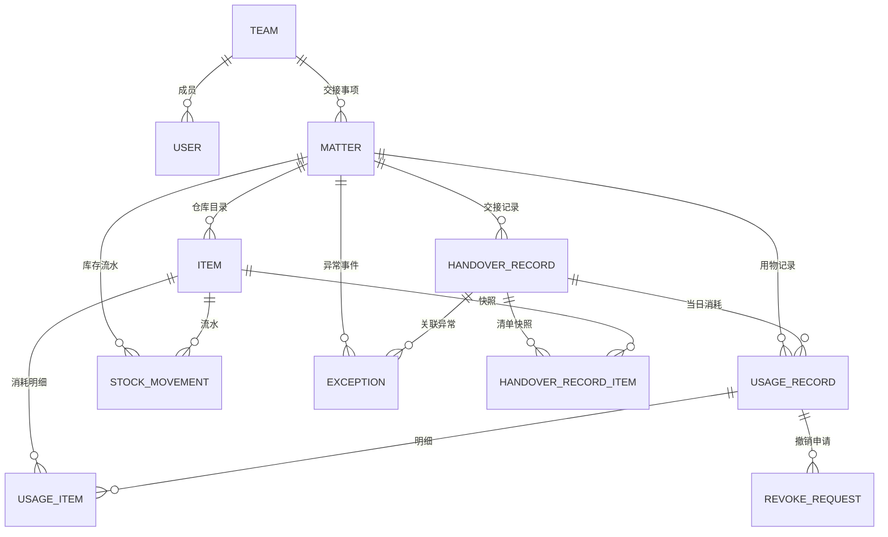

# 易交接 —— 数据模型设计

> 数据库：SQLite（WAL）　ORM：Drizzle ORM　迁移：packages/db/src/migrations
> 约定：时间戳一律 `integer({ mode: "timestamp_ms" })`；业务日期用 `text` 存 `YYYY-MM-DD`（团队时区）；金额/库存用整数。

## 1. 关系总览

## 2. 表定义

### 2.1 team（团队）

| 字段                  | 类型       | 约束                                                      | 说明                             |
| --------------------- | ---------- | --------------------------------------------------------- | -------------------------------- |
| id                    | text       | PK                                                        | uuid                             |
| name                  | text       | NOT NULL, UNIQUE                                          | 团队名称                         |
| code                  | text       | NOT NULL, UNIQUE                                          | 团队编码（大写字母/数字/短横线） |
| description           | text       | NULL                                                      | 描述                             |
| timezone              | text       | NOT NULL DEFAULT 'Asia/Shanghai'                          | 业务时区                         |
| status                | text       | NOT NULL DEFAULT 'active', CHECK in ('active','archived') | 状态                             |
| createdAt / updatedAt | integer ms | NOT NULL                                                  | 审计                             |

### 2.2 user（用户，扩展 Better Auth）

Better Auth 负责会话与密码；业务字段直接加在同一张表。

| 字段                  | 类型       | 约束                                                                      | 说明                                     |
| --------------------- | ---------- | ------------------------------------------------------------------------- | ---------------------------------------- |
| id                    | text       | PK                                                                        | Better Auth 生成                         |
| name                  | text       | NOT NULL                                                                  | 姓名（展示名）                           |
| email                 | text       | NOT NULL UNIQUE                                                           | 内部邮箱（由 username 生成，不对外展示） |
| username              | text       | NOT NULL UNIQUE                                                           | 登录名（小写）                           |
| displayUsername       | text       | NULL                                                                      | 展示用登录名                             |
| role                  | text       | NOT NULL DEFAULT 'member', CHECK in ('super_admin','team_admin','member') | 角色                                     |
| teamId                | text       | NULL, FK team.id ON DELETE RESTRICT                                       | 所属团队；超级管理员可为空               |
| status                | text       | NOT NULL DEFAULT 'active', CHECK in ('active','disabled')                 | 启用状态                                 |
| phone                 | text       | NULL                                                                      | 手机号                                   |
| createdAt / updatedAt | integer ms | NOT NULL                                                                  | 审计                                     |

> 登录名唯一性由应用校验 + 数据库唯一索引双重保证；密码只存在于 Better Auth 的 `account` 表（scrypt 哈希）。

### 2.3 matter（交接事项 / 用物仓库）

| 字段                  | 类型       | 约束                                                      | 说明                             |
| --------------------- | ---------- | --------------------------------------------------------- | -------------------------------- |
| id                    | text       | PK                                                        | uuid                             |
| teamId                | text       | NOT NULL FK team.id                                       | 所属团队                         |
| name                  | text       | NOT NULL                                                  | 事项名称                         |
| code                  | text       | NULL                                                      | 可选编码，团队内唯一             |
| description           | text       | NULL                                                      | 描述                             |
| status                | text       | NOT NULL DEFAULT 'active', CHECK in ('active','archived') | 状态                             |
| qrToken               | text       | NOT NULL UNIQUE                                           | 二维码 token（高熵，生成后不变） |
| qrVersion             | integer    | NOT NULL DEFAULT 1                                        | 二维码版本（变更 +1）            |
| qrChangedAt           | integer ms | NULL                                                      | 最近变更时间                     |
| createdAt / updatedAt | integer ms | NOT NULL                                                  | 审计                             |

约束：`UNIQUE(teamId, code)`（code 非空时由应用保证）；同一团队名称唯一。

### 2.4 item（物品 / 仓库目录）

| 字段                  | 类型       | 约束                                                      | 说明         |
| --------------------- | ---------- | --------------------------------------------------------- | ------------ |
| id                    | text       | PK                                                        | uuid         |
| matterId              | text       | NOT NULL FK matter.id                                     | 所属交接事项 |
| name                  | text       | NOT NULL                                                  | 物品名称     |
| spec                  | text       | NULL                                                      | 规格         |
| unit                  | text       | NOT NULL                                                  | 单位         |
| category              | text       | NULL                                                      | 分类         |
| stock                 | integer    | NOT NULL DEFAULT 0, CHECK >= 0                            | 当前库存     |
| minStock              | integer    | NOT NULL DEFAULT 0, CHECK >= 0                            | 低库存阈值   |
| location              | text       | NULL                                                      | 存放位置     |
| note                  | text       | NULL                                                      | 备注         |
| status                | text       | NOT NULL DEFAULT 'active', CHECK in ('active','archived') | 状态         |
| createdAt / updatedAt | integer ms | NOT NULL                                                  | 审计         |

约束：同一 matter 下 name 唯一。

### 2.5 stock_movement（库存流水，不可变）

| 字段           | 类型                                                                             | 说明                              |
| -------------- | -------------------------------------------------------------------------------- | --------------------------------- |
| id             | text PK                                                                          |                                   |
| matterId       | text NOT NULL                                                                    | 冗余便于查询                      |
| itemId         | text NOT NULL FK item.id                                                         |                                   |
| type           | text NOT NULL CHECK in ('initial','inbound','consumption','revoke','adjustment') | 流水类型                          |
| quantityDelta  | integer NOT NULL                                                                 | 变化量（消耗为负）                |
| stockAfter     | integer NOT NULL CHECK >= 0                                                      | 操作后库存                        |
| operatorUserId | text NOT NULL                                                                    | 操作人                            |
| operatorName   | text NOT NULL                                                                    | 操作人姓名快照                    |
| refType        | text NULL                                                                        | 关联类型：usage / record / manual |
| refId          | text NULL                                                                        | 关联 id                           |
| note           | text NULL                                                                        | 原因/备注                         |
| createdAt      | integer ms NOT NULL                                                              |                                   |

### 2.5.1 stock_transfer（调拨记录）

| 字段                                        | 类型    | 约束             | 说明                |
| ------------------------------------------- | ------- | ---------------- | ------------------- |
| id                                          | text    | PK               |                     |
| matter_id                                   | text    | FK matter        | 所属事项            |
| from_sub_warehouse_id / to_sub_warehouse_id | text    | FK sub_warehouse | 调出/调入，必须不同 |
| source_item_id / target_item_id             | text    | FK item          | 来源/目标物品       |
| item_name / item_spec / unit                | text    | 快照             | 调拨物品信息        |
| quantity                                    | integer | > 0              | 调拨数量            |
| operator_user_id / operator_name            | text    |                  | 操作人              |
| note                                        | text    |                  | 备注                |
| created_at                                  | integer | timestamp_ms     |                     |

### 2.6 handover_record（交接记录）

| 字段                  | 类型                                                                          | 说明                   |
| --------------------- | ----------------------------------------------------------------------------- | ---------------------- |
| id                    | text PK                                                                       |                        |
| matterId              | text NOT NULL FK matter.id                                                    |                        |
| recordDate            | text NOT NULL                                                                 | YYYY-MM-DD（团队时区） |
| status                | text NOT NULL CHECK in ('pending_acceptance','accepted','handover_submitted') | 状态                   |
| acceptedByUserId      | text NULL                                                                     | 接班人 id              |
| acceptedByName        | text NULL                                                                     | 接班人姓名快照         |
| acceptedAt            | integer ms NULL                                                               | 接班时间               |
| handoverByUserId      | text NULL                                                                     | 交班人 id              |
| handoverByName        | text NULL                                                                     | 交班人姓名快照         |
| handoverAt            | integer ms NULL                                                               | 交班时间               |
| acceptanceNote        | text NULL                                                                     | 验收备注               |
| handoverNote          | text NULL                                                                     | 交班备注               |
| createdAt / updatedAt | integer ms NOT NULL                                                           |                        |

约束：`UNIQUE(matterId, recordDate)`。

### 2.7 handover_record_item（交接清单快照）

| 字段                       | 类型                                                  | 说明                         |
| -------------------------- | ----------------------------------------------------- | ---------------------------- |
| id                         | text PK                                               |                              |
| recordId                   | text NOT NULL FK handover_record.id ON DELETE CASCADE |                              |
| itemId                     | text NOT NULL FK item.id                              |                              |
| itemName / itemSpec / unit | text                                                  | 快照，物品改名后历史不变     |
| expectedQty                | integer NOT NULL                                      | 生成清单时的库存（应有数量） |
| checked                    | integer boolean NOT NULL DEFAULT false                | 是否已核对                   |
| actualQty                  | integer NULL                                          | 实盘数量（不填视为等于应有） |
| note                       | text NULL                                             | 单行备注                     |
| acceptedAt                 | integer ms NULL                                       | 验收时间                     |
| handoverChecked            | integer boolean NOT NULL DEFAULT false                | 交班核对                     |
| handoverActualQty          | integer NULL                                          | 交班实盘                     |
| handoverNote               | text NULL                                             | 交班备注                     |

### 2.8 usage_record（用物消耗记录）

| 字段             | 类型          | 约束                   | 说明                 |
| ---------------- | ------------- | ---------------------- | -------------------- |
| matter_id        | text          | FK matter              | 所属事项             |
| sub_warehouse_id | text          | FK sub_warehouse       | 使用发生的班次子仓库 |
| used_at_time     | text          | nullable, HH:mm        | 补录的具体使用时间   |
| is_backfill      | integer(bool) | NOT NULL default false | 是否补登记           |
| backfill_reason  | text          | 补录时必填 2–300 字    | 补录原因             |

| 字段                  | 类型                                                         | 说明                     |
| --------------------- | ------------------------------------------------------------ | ------------------------ |
| id                    | text PK                                                      |                          |
| matterId              | text NOT NULL FK matter.id                                   |                          |
| recordId              | text NULL FK handover_record.id                              | 关联当日交接记录（可空） |
| usedAt                | text NOT NULL                                                | 使用日期 YYYY-MM-DD      |
| patientName           | text NOT NULL                                                | 患者姓名                 |
| patientType           | text NOT NULL CHECK in ('outpatient','inpatient')            | 门诊/住院                |
| patientNo             | text NOT NULL                                                | 登记号                   |
| patientPhone          | text NULL                                                    | 电话（可选）             |
| operatorUserId        | text NOT NULL                                                | 操作员账号               |
| operatorName          | text NOT NULL                                                | 操作员姓名快照           |
| note                  | text NULL                                                    | 备注                     |
| status                | text NOT NULL CHECK in ('active','revoke_pending','revoked') | 状态                     |
| revokedAt             | integer ms NULL                                              | 撤销生效时间             |
| createdAt / updatedAt | integer ms NOT NULL                                          |                          |

### 2.9 usage_item（消耗明细）

| 字段                       | 类型                                               | 说明     |
| -------------------------- | -------------------------------------------------- | -------- |
| id                         | text PK                                            |          |
| usageId                    | text NOT NULL FK usage_record.id ON DELETE CASCADE |          |
| itemId                     | text NOT NULL FK item.id                           |          |
| itemName / itemSpec / unit | text                                               | 快照     |
| quantity                   | integer NOT NULL CHECK > 0                         | 消耗数量 |

### 2.10 revoke_request（撤销申请）

| 字段                                | 类型                                                     | 说明     |
| ----------------------------------- | -------------------------------------------------------- | -------- |
| id                                  | text PK                                                  |          |
| usageId                             | text NOT NULL FK usage_record.id                         |          |
| status                              | text NOT NULL CHECK in ('pending','approved','rejected') |          |
| reason                              | text NOT NULL                                            | 申请原因 |
| requestedByUserId / requestedByName | text NOT NULL                                            | 申请人   |
| reviewedByUserId / reviewedByName   | text NULL                                                | 审批人   |
| reviewedAt                          | integer ms NULL                                          |          |
| reviewNote                          | text NULL                                                | 审批意见 |
| createdAt / updatedAt               | integer ms NOT NULL                                      |          |

约束：同一 usageId 最多一条 pending 申请（局部唯一索引）。

### 2.11 exception_event（异常事件）

| 字段                              | 类型                                                                  | 说明         |
| --------------------------------- | --------------------------------------------------------------------- | ------------ |
| id                                | text PK                                                               |              |
| matterId                          | text NOT NULL FK matter.id                                            |              |
| recordId                          | text NULL FK handover_record.id                                       | 关联交接记录 |
| itemId                            | text NULL FK item.id                                                  | 关联物品     |
| type                              | text NOT NULL CHECK in ('missing','damaged','count_mismatch','other') | 类型         |
| severity                          | text NOT NULL CHECK in ('low','medium','high')                        | 严重程度     |
| description                       | text NOT NULL                                                         | 描述         |
| status                            | text NOT NULL CHECK in ('open','resolved')                            | 状态         |
| reportedByUserId / reportedByName | text NOT NULL                                                         | 上报人       |
| resolvedByUserId / resolvedByName | text NULL                                                             | 处置人       |
| resolution                        | text NULL                                                             | 处置说明     |
| resolvedAt                        | integer ms NULL                                                       |              |
| createdAt / updatedAt             | integer ms NOT NULL                                                   |              |

## 3. 关键不变量与事务

1. **库存非负**：任何扣减前校验 `stock - qty >= 0`，在同一事务内 `UPDATE ... SET stock = stock - qty WHERE id = ? AND stock >= qty`；影响行数为 0 则回滚并抛错。
2. **消耗 = 扣减 + 流水 + 明细**：同一事务写入 usage_record、usage_item、stock_movement。
3. **撤销 = 状态 + 恢复 + 流水**：审批通过时事务内把记录置 revoked、恢复库存、写 `revoke` 流水；重复审批拒绝。
4. **交接快照基本不可变**：验收/交班只更新 checked/actual/时间戳，不改 expectedQty 与快照字段。唯一例外是未交班清单（`pending_acceptance`、`accepted`）：管理员修改物品名称/规格/单位时同步这三个字段；一旦提交交班，快照不再随物品档案变化。
5. **唯一当日记录**：并发下用 `INSERT ... ON CONFLICT DO NOTHING` 或捕获唯一冲突后重查。
6. **审计快照**：所有记录保存操作人姓名快照，账号改名/停用后历史仍可读。
7. **团队隔离**：所有查询必须带 `teamId`（通过 matter 关联或用户所属团队），越权返回 NOT_FOUND。
8. **物品彻底删除**：仅当没有 `usage_item` 与 `handover_record_item` 时允许物理删除，并在同一事务内清理 `stock_movement`、`stock_transfer`（源/目标）与 `item_image`；否则只能停用。

## 4. 索引建议

- `user(username)` 唯一、`user(teamId)`
- `matter(teamId, status)`、`matter(qrToken)` 唯一
- `item(matterId, status)`、`item(matterId, name)` 唯一
- `handover_record(matterId, recordDate)` 唯一、`handover_record(matterId, createdAt)`
- `usage_record(matterId, usedAt)`、`usage_record(recordId)`、`usage_record(status)`
- `stock_movement(itemId, createdAt)`、`stock_movement(matterId, createdAt)`
- `revoke_request(status)`、`exception_event(matterId, status)`
